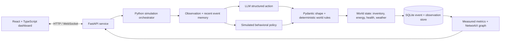

# EDEN

### Emergent Digital Ecosystem Network

EDEN is a local research prototype for observing how LLM-driven agents and scripted behavioral policies act in a shared society with scarce resources. Agents propose actions; the deterministic world engine validates and applies them. Each run produces inspectable event records and measured metrics.

> **Research status:** EDEN is an experimental prototype, not evidence about real people or general AI behavior. The current dashboard and metrics have important caveats documented below. The completed pilot so far is a five-seed, seven-day policy-only baseline; no valid AI-only or mixed comparison has been completed.

## At a glance

- Eight named inhabitants across four occupations: farmer, merchant, builder, and researcher.
- Three population conditions: all LLM-tagged, mixed, and all simulated behavioral policies.
- Structured actions checked against deterministic simulation rules.
- SQLite storage for active residents, observations, actions, events, interaction links, and trial summaries.
- React, TypeScript, Vite, Recharts dashboard with a schematic settlement, live event stream, profiles, economy, network view, and research lab.
- Local development and localhost-only Docker deployment.

## Dashboard views

The dashboard has World Overview, Population, Economy, Social Network, Event Timeline, Research Lab, and Experiment Comparison views. Residents can be selected to inspect their inventory, health, energy, objectives, and recent recorded events. Simulation state is sent to the UI through a WebSocket.

The settlement image is currently a hand-authored SVG schematic. It is not a geographic simulation or a PixiJS implementation. Screenshots should be captured from the running application; see [the screenshot guide](docs/SCREENSHOTS.md). No live-application screenshots are included yet.

## Architecture



### One simulation day

1. The engine reads the current resident and world state.
2. It stores an observation for each inhabitant, including their objective, population snapshot, recent event results, and available action types.
3. An AI-tagged inhabitant requests one structured action from the selected provider. A behavioral-policy inhabitant chooses an action through the separate local policy function.
4. Pydantic validates the action's shape and bounds. The world engine checks applicable resource and target rules. The LLM never writes world state directly.
5. The engine applies actions, consumes food, updates health and energy, and rolls seeded environmental events.
6. Actions, outcomes, and environment events are saved to SQLite. Current state and metrics are returned to the dashboard.

Provider errors are currently recorded as `provider_fallback` events and that agent uses the deterministic policy fallback. **An experiment condition containing any fallback must not be reported as a pure LLM condition.**

## Technology choices

| Layer | Tools | Why they are used |
|---|---|---|
| Dashboard | React, TypeScript, Vite | Interactive client, typed state, and fast local builds |
| Visual analytics | Recharts, SVG, custom CSS, Lucide icons | Charts and a lightweight interactive settlement/network display |
| API | Python, FastAPI, Pydantic, WebSockets | Independently testable simulation service, request validation, and live state updates |
| Simulation | Custom Python engine | Central authority for action validation and deterministic world changes |
| Data | SQLite | Local, inspectable persistence without a hosted database |
| Network analysis | NetworkX | Calculates graph measures from recorded interaction links |
| Model provider | Gemini or Groq OpenAI-compatible endpoint | Configurable structured action selection; credentials stay in environment configuration |
| Tests | Python `unittest` | Engine checks for action rules, progression, reproducibility, and metrics |

Tailwind is configured in the Vite build, while most of the existing interface styling lives in `src/style.css`. PixiJS was in the original design brief but is not part of the current implementation.

## Experimental conditions

| Condition | Intended population | Current implementation notes |
|---|---|---|
| **A — AI society** | 8 LLM-powered agents | Requires an available, correctly configured provider. Check fallback events before accepting a run. |
| **B — Mixed society** | 4 LLM-powered + 4 policy agents | The current assignment is the first four fixed roster entries. That assigns both farmers and both merchants to AI, confounding agent type with occupation. Randomize/counterbalance before drawing comparisons. |
| **C — Policy baseline** | 8 simulated behavioral-policy agents | Runs without a provider. Profiles are cooperative, competitive, cautious, and opportunistic; these are scripted policies, not human participants. |

Switching condition resets the active world. Initial resources and world rules are held the same, but condition B's fixed roster assignment is a design flaw to address before a formal comparison. Policy choices and environmental events use seeded randomness. A seed does **not** make an LLM provider response deterministic; record provider/model and repeat AI trials.

## Metrics and definitions

Metrics are calculated from current stored world state, events, and interaction links. The names below describe current prototype calculations, not validated social-science constructs.

| Metric | Current calculation | Important limitation |
|---|---|---|
| Survival rate | Residents with health above zero / total residents | Can hide hunger and declining health. Report health and food insecurity alongside it. |
| Cooperation rate | Targeted trade/help/negotiate/socialize events / action events | Interaction proxy, not pure cooperation; paid trade and social contact are included. |
| Trade volume | Units in successful trade/negotiation actions | Resource units, not money value or economic surplus. |
| Wealth Gini | Gini over money + raw counts of food, wood, and stone | Adds unlike units as though they have equal value. Treat as a rough prototype index. |
| Network density | NetworkX density over an undirected graph from recorded links | Measures contact structure, not influence or relationship quality. |
| Resource efficiency | Remaining food + wood + stone per inhabitant | This is inventory per capita, not production efficiency. |
| Mean trust | Mean trust value of stored directed links | Small and potentially uneven samples; show the distribution too. |
| Social inequality | (max asset score - min asset score) / total asset score | Uses the same mixed-unit asset score and is not a standard inequality measure. |

## Pilot result currently in the database

Five condition C trials were run for seven days using seeds 42–46. The descriptive mean survival rate was 100%, cooperation proxy 6.98%, trade volume 4 units, wealth Gini 0.0838, network density 0.143, mean trust 0.12, and remaining inventory 6.6 units per inhabitant. Non-farmers had no food at the end of every trial even though their health remained above zero. This exposes a limitation in the headline survival measure and current policy/economy rules.

This is a small pilot of the scripted baseline. The AI-only run was interrupted by Gemini's free-tier request quota and recorded as incomplete; Groq returned an access-denied response in that run environment. **There is no valid A-vs-C or B-vs-C result.** The local `backend/eden.db` contains the saved pilot summaries but is ignored by Git and must not be committed.

## Run locally

Requirements: Python 3.10+, Node.js 20+, npm, and internet access to install dependencies. Run the backend and frontend in separate terminals.

### 1. Backend (PowerShell)

```powershell
Set-Location .\backend
py -3 -m venv .venv
.\.venv\Scripts\Activate.ps1
python -m pip install -r requirements.txt
python -m uvicorn eden.main:app --reload
```

The API is at <http://127.0.0.1:8000>; interactive API docs are at <http://127.0.0.1:8000/docs>. On first launch, the service initializes `backend/eden.db` and seeds the world.

If PowerShell blocks activation, run the virtual-environment Python directly:

```powershell
.\.venv\Scripts\python.exe -m pip install -r requirements.txt
.\.venv\Scripts\python.exe -m uvicorn eden.main:app --reload
```

### 2. Frontend (second terminal, project root)

```powershell
npm install
npm run dev
```

Open the localhost URL printed by Vite, normally <http://localhost:5173>. The Vite development server proxies `/api` and `/ws` to the backend.

### 3. Run tests and make a production frontend build

```powershell
# From backend with its virtual environment active
python -m unittest discover -s tests

# From the project root
npm run build
```

## Model-provider configuration

The app runs condition C without model credentials. To try condition A or B:

1. Copy `backend/.env.example` to `backend/.env`.
2. Set `EDEN_LLM_PROVIDER=gemini` and `GEMINI_API_KEY=...`, or select `groq` and set `GROQ_API_KEY=...`.
3. Optionally set `EDEN_LLM_MODEL` and `EDEN_LLM_ENDPOINT`; blank values use provider defaults.
4. Restart the backend and run a short trial. Inspect `provider_fallback` events; exclude any affected run from pure-AI results.

Never commit `backend/.env`, post key values in screenshots, or put credentials in source. If a key has been shared or exposed, rotate it with its provider. Free-tier quotas and provider availability can prevent AI trials from completing.

## Local Docker deployment

Docker Compose runs the API and built frontend behind Nginx. The web interface is bound to `127.0.0.1:8080`; the API port is internal to the Compose network. SQLite data lives in the named `eden-data` volume.

```powershell
Copy-Item backend/.env.example backend/.env
# Edit backend/.env if you want an LLM provider; condition C needs no key.
docker compose up --build -d
```

Open <http://localhost:8080>. Check the containers with `docker compose ps` and logs with `docker compose logs -f`. Stop them with `docker compose down`; the named database volume remains. To also delete the saved database, use `docker compose down -v` (this permanently removes the local experiment database).

### Public deployment status

The provided Compose setup is for localhost use. EDEN currently has no authentication or user authorization, and API routes can reset the active world or launch provider-backed trials. Do not expose it directly to the public internet or share a running instance with untrusted users. Public hosting needs authentication, rate/cost limits, protected database backups, trial-level data isolation, and a security review first.

## Screenshots

Capture real screenshots only after the app is running. The [screenshot guide](docs/SCREENSHOTS.md) lists recommended views, filenames, captions, and a privacy checklist. Expected images include the world overview, an agent profile, economy, social network, and completed research lab. The repository does not yet include captured screenshots.

## Data and API

SQLite tables: `agents` (active population), `observations` (decision-time snapshots), `events` (actions and outcomes), `links` (interaction-derived trust edges), `config` (active condition/seed), and `experiments` (saved per-trial summaries).

| Route | Purpose |
|---|---|
| `GET /api/health` | API health check |
| `GET /api/state` | Current world, residents, recent events, and metrics |
| `POST /api/reset` | Reset world with condition and seed |
| `POST /api/step` | Advance one simulated day |
| `POST /api/act` | Validate and execute one action |
| `GET /api/agents/{id}/history` | Read events involving an inhabitant |
| `POST /api/agent/{id}/decide` | Request and record a single agent decision |
| `POST /api/experiments/run` | Run repeated trials and store summaries |
| `GET /api/experiments` | List saved trial summaries |
| `WebSocket /ws` | Receive current state updates |

**Persistence limitation:** the current repeated-trial runner resets active agents, events, links, and observations before the next trial. It stores each trial's metric summary, but not each trial's raw event history. Add a trial ID to all raw records before treating it as a research archive.

## Roadmap

### Milestone 1 — Make the research records trustworthy

- Add trial IDs and preserve raw observations/events/links per trial.
- Validate that seed, condition, action log, and final state reconcile.
- Make any provider fallback invalidate or clearly flag an AI trial.
- Add food-insecurity days, per-agent health, help rate, transfer value, and per-resource inequality.

### Milestone 2 — Improve experimental design

- Counterbalance the AI/policy assignment within occupation and personality.
- Run matched seed sets and report means, spread, and trial-level results.
- Store provider/model/prompt/schema versions and provider error/cost metadata.

### Milestone 3 — Improve agent and economy realism

- Implement distinct negotiation outcomes, prices, affordability, skills, and richer personal memories.
- Refine policy profiles and document each deterministic decision rule.
- Track relationship history and trust changes with interpretable baseline measures.

### Milestone 4 — Complete the product and presentation

- Add authentication and rate/cost protection before any shared or public deployment.
- Add accessible UI, larger screen captures, and clearly labeled comparison charts.
- Consider PixiJS/isometric rendering only after the experiment and data pipeline are sound.

## Current limitations

- Eight-person prototype only; no multi-generation simulation or implemented governance system.
- AI provider results vary and are not controlled by the simulation seed.
- The fixed condition B roster makes agent type and occupation confounded.
- Experiment summaries persist but raw logs are erased when the next trial resets the active world.
- `survival_rate`, `cooperation_rate`, `wealth_gini`, and `resource_efficiency` need refinement before formal claims.
- No authentication: deployment stays localhost-only.
- World rendering is a schematic SVG, not PixiJS.
- No findings from conditions A or B are available yet.

## Repository layout

```text
backend/
  eden/
    ai.py          # Optional Gemini/Groq structured-action connector
    engine.py      # Simulation, policies, rules, persistence, metrics
    main.py        # FastAPI routes and WebSocket
  tests/           # Backend unit tests
src/               # React dashboard
deploy/            # Nginx reverse-proxy configuration
docs/              # Screenshot instructions and project docs
Dockerfile         # Frontend build + Nginx image
backend/Dockerfile # API image
compose.yaml       # Local full-stack deployment
```

## License

No license has been added yet. Until a license is chosen and added, do not assume this repository grants permission to redistribute or reuse the project.
